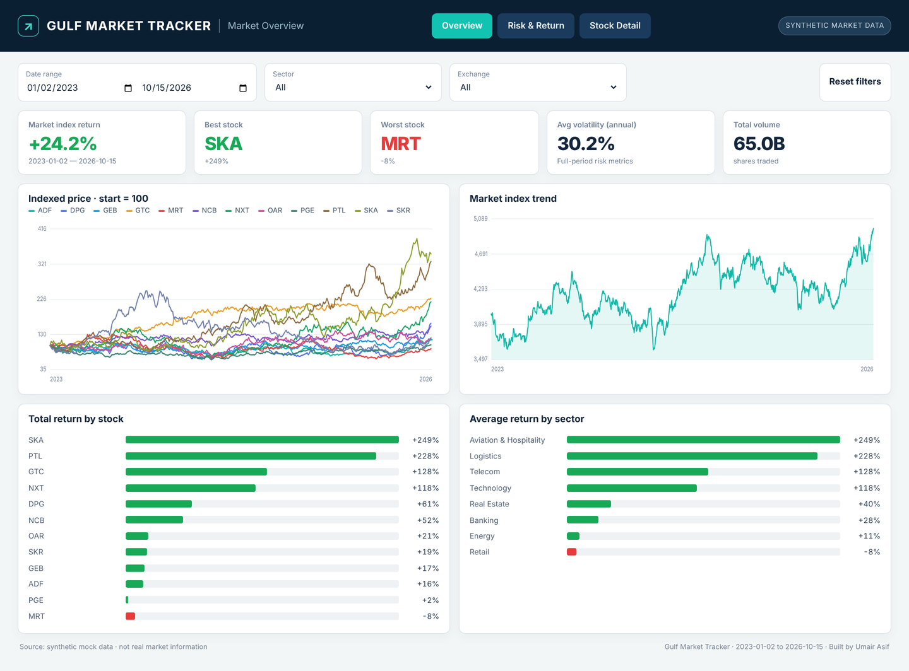
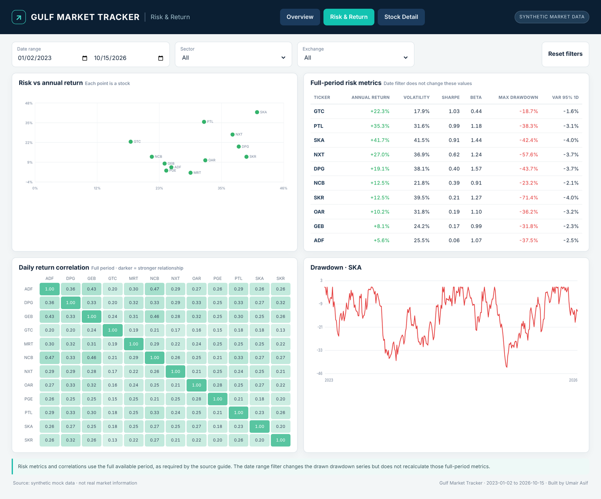
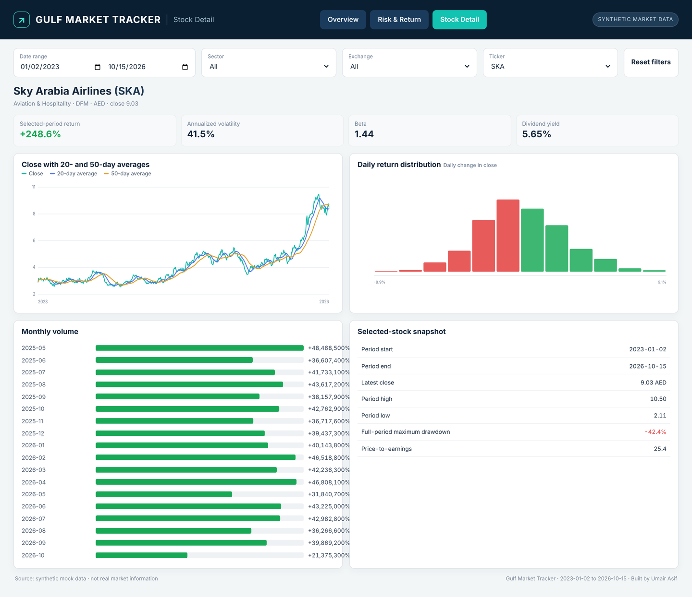

# Gulf Market Tracker: Stock Market Risk & Return Dashboard

An interactive, three-page dashboard that tracks 12 Gulf equities across the DFM, ADX and Tadawul exchanges from January 2023 to October 2026. It compares returns, measures risk (volatility, beta, Sharpe ratio, drawdown, VaR) and shows how the stocks move together.

> **Note:** every company, price and index value is synthetic mock data created for learning. The numbers do not describe real companies or the real market.

**[▶ Open the live dashboard](https://umairasifofficalll-code.github.io/gulf-market-tracker-dashboard/)**

## Business Problem
An investor looking at Gulf stocks needs to know:
- Which stocks and sectors delivered the best returns?
- Which stocks paid for that return with the most risk?
- Which stock gave the best **risk-adjusted** return?
- How closely do the stocks move together, and is there room to diversify?

## Dataset
| File | Rows | Contents |
|---|---|---|
| `stock_prices_mock.csv` | 11,734 | Daily open, high, low, close, volume and return for 12 tickers |
| `stock_info_mock.csv` | 12 | Company, sector, exchange, currency, shares, dividend yield, P/E |
| `market_index_mock.csv` | 977 | Daily market index level and return |
| `stocks_dashboard.csv` | 11,734 | Joined table with 20/50-day moving averages and drawdown, ready for BI tools |
| `stock_metrics.csv` | 12 | Annual return, volatility, beta, max drawdown, 1-day VaR 95%, Sharpe |
| `correlation_long.csv` | 144 | Pairwise daily-return correlations |

## Dashboard Pages
1. **Market Overview:** index return, best and worst stock, average volatility, total volume, indexed price lines, market index trend, return by stock and by sector.
2. **Risk & Return:** risk vs return scatter, full-period risk metrics table ranked by Sharpe ratio, correlation heatmap and drawdown chart.
3. **Stock Detail:** close price with 20- and 50-day moving averages, daily return distribution, monthly volume and a stock snapshot.

Filters for date range, sector, exchange and ticker work across the pages.

## Key Findings
1. The market index returned **+24.2%** over the period.
2. **Sky Arabia Airlines (SKA)** was the top performer at **+249%**, but it was also the most volatile stock (41.5% a year).
3. **Gulf Telecom (GTC)** gave the best risk-adjusted return: **Sharpe 1.03**, the lowest volatility (17.9%), a beta of 0.44 and the smallest drawdown (-18.7%).
4. **Skyline Realty (SKR)** suffered the deepest fall, a **-71.4%** maximum drawdown.
5. **Meraki Retail (MRT)** was the only stock with a negative return (-8%), so Retail was the only losing sector.
6. The average correlation between stocks is only **0.26**, so a mixed portfolio offers real diversification. The two banks NCB and ADF move together the most (0.47).

## Tools
Python (pandas) for data preparation and risk metrics · HTML, CSS and JavaScript (SVG charts) for the interactive dashboard · GitHub Pages for hosting · CSV outputs ready for Power BI or Tableau.

## Screenshots
| Risk & Return | Stock Detail |
|---|---|
|  |  |

## How to Run
- Open the [live dashboard](https://umairasifofficalll-code.github.io/gulf-market-tracker-dashboard/), or
- Clone the repo and serve it locally: `python -m http.server` then open `http://localhost:8000`.
- To rebuild the dashboard in Power BI or Tableau, load `stocks_dashboard.csv`, `stock_metrics.csv` and `correlation_long.csv`. `Stock_Market_Dashboard_Guide.docx` describes each page.

## Limitations
The data is synthetic. Risk metrics and correlations use the full period and do not change with the date filter. Returns are price returns and exclude dividends.

## Author
**Umair Asif**, Data Analyst
[LinkedIn](https://www.linkedin.com/in/umair-asif-data/) · [GitHub](https://github.com/umairasifofficalll-code) · [Portfolio](https://umairasifofficalll-code.github.io/My-Portfolio/)
